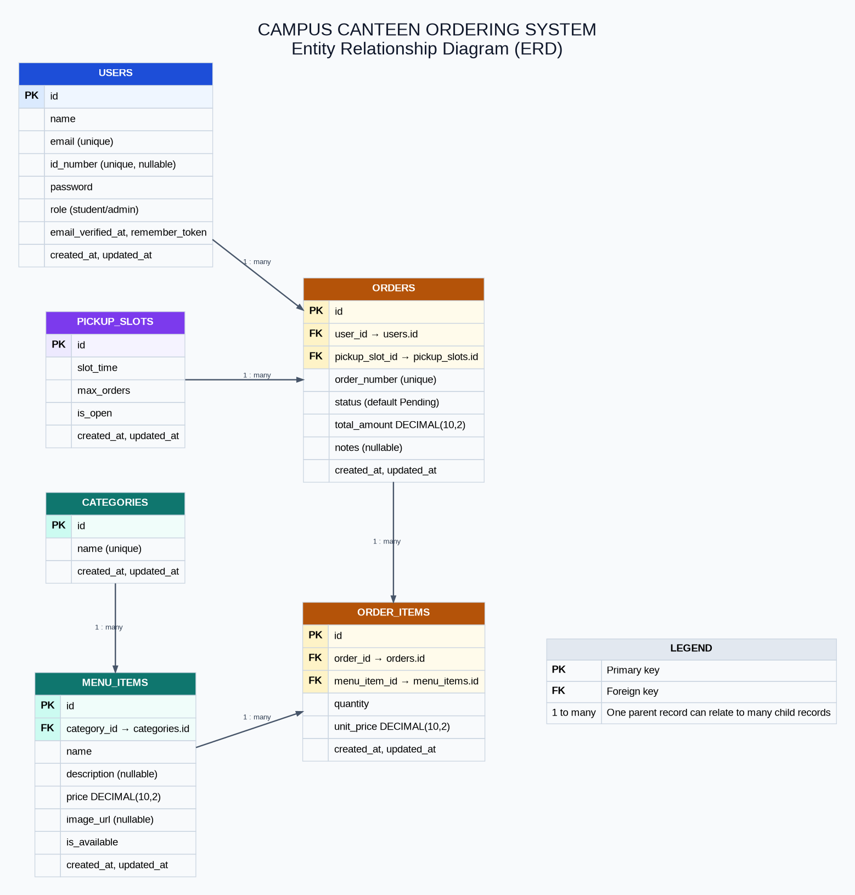

# Campus Canteen Ordering System

**Developer:** Clarke David Murcia  
**Project:** BSIT 3 - Section 1 || capstone project  
**Client:** Students and canteen staff of Mater Dei College  
**Theme:** A responsive campus canteen portal for browsing food, ordering ahead, and collecting meals during scheduled pickup slots.

The system gives Mater Dei College students a convenient way to explore the canteen menu and prepare orders. Canteen staff can manage menu categories, menu items, pickup slots, and order status from an admin dashboard.

## Features

- Responsive storefront, menu browsing, search, categories, favorites, and cart
- Student registration, login, logout, and current-user lookup using Laravel Sanctum
- Order creation, personal order history, order details, and cancellation through the API
- Admin dashboard and controls for categories, menu items, pickup slots, and order status
- Server-side validation, role checks, and paginated API lists
- Seeded menu catalog, pickup slots, and demo student/admin accounts

Some frontend ordering pages currently use local preview data; registration and login are connected to the API.

## Tech stack

- Frontend: React 19, Vite, React Router, Axios, Lucide
- Backend: Laravel 13, PHP 8.3+, Laravel Sanctum
- Database: SQLite by default; MySQL/MariaDB can be configured
- Tools: Composer, npm

## Repository layout

```text
backend/       Laravel API, migrations, models, seeders
frontend/      React single-page application
docs/          Project proposal, presentation, ERD, workflow guide, and screenshots
```

## Setup

### Requirements

PHP 8.3+, Composer, Node.js/npm, and a database supported by Laravel. The supplied backend environment example uses SQLite. For MySQL/MariaDB, configure the database values in `backend/.env` and create the database before migrating.

### 1. Configure and run Laravel

From the repository root:

```powershell
cd backend
composer install
Copy-Item .env.example .env
php artisan key:generate
php artisan migrate --seed
php artisan serve
```

The API is available at `http://127.0.0.1:8000/api`.

### 2. Configure and run React

Open a second terminal at the repository root:

```powershell
cd frontend
npm install
npm run dev
```

Open the Vite URL shown in the terminal (normally `http://localhost:5173`). `frontend/.env.example` configures the API proxy to `http://127.0.0.1:8000`.

## Seeded demo accounts

The seeder creates one admin and two student accounts, along with canteen menu items, pickup slots, and example orders in pending, preparing, ready, completed, and cancelled states:

| Role | Email | Password |
|---|---|---|
| Admin | `admin@canteen.local` | `admin123` |
| Student | `student@campus.local` | `student123` |
| Student | `student2@campus.local` | `student123` |

These seeded accounts are provided solely for demonstrating and reviewing the student and admin workflows locally. They are sample accounts, not real campus users; the sample orders are demonstration records. The credentials are public by design, so do not reuse them or deploy them in a live environment. Replace or remove the demo accounts and sample records before production use.

## API documentation

Base URL: `http://127.0.0.1:8000/api`. Protected endpoints use `Authorization: Bearer <token>`. Admin endpoints require an authenticated admin account.

| Method | Endpoint | Access | Purpose |
|---|---|---|---|
| POST | `/register` | Public | Register a student account |
| POST | `/login` | Public | Sign in and receive a token |
| POST | `/logout` | Authenticated | Revoke the current token |
| GET | `/user` | Authenticated | Get the current account |
| GET | `/menu` | Public | Browse menu items; supports search, category, and availability filters |
| GET | `/categories` | Public | List categories |
| GET | `/pickup-slots` | Public | List pickup slots |
| GET | `/orders` | Authenticated | List the current user's orders; optional status filter |
| POST | `/orders` | Authenticated | Create an order |
| GET | `/orders/{order}` | Authenticated | View an order owned by the current user |
| PATCH | `/orders/{order}/cancel` | Authenticated | Cancel an eligible order |
| GET | `/admin/dashboard` | Admin | View dashboard metrics |
| POST, PUT/PATCH, DELETE | `/admin/categories[/{category}]` | Admin | Create, update, or delete categories |
| POST, PUT/PATCH, DELETE | `/admin/menu-items[/{menu_item}]` | Admin | Create, update, or delete menu items |
| POST, PUT/PATCH, DELETE | `/admin/pickup-slots[/{pickup_slot}]` | Admin | Create, update, or delete pickup slots |
| GET | `/admin/orders` | Admin | List all orders; optional status filter |
| PATCH | `/admin/orders/{order}/status` | Admin | Update order status |
| DELETE | `/admin/orders/{order}` | Admin | Delete an order |

The admin resource entries also expose `GET` list routes; their individual `GET /{id}` routes are excluded. Route definitions are in [`backend/routes/api.php`](backend/routes/api.php).

## Database design

The ERD shows the six core application tables and their key relationships. Laravel support tables such as sessions, password reset tokens, and Sanctum personal access tokens are omitted.



## Project proposal

Read the [Campus Canteen project proposal](docs/Campus_Canteen_ProjectProposal_Minimal.docx) for the project background and original scope.

## Presentation

See the [Campus Canteen presentation](docs/Campus_Canteen_Presentation.pptx) for the project proposal, design, features, technology stack, and implementation progress.

## Presentation and screenshots

Application captures belong in [`docs/screenshots/`](docs/screenshots/). Suggested views are Home, Menu, Cart or Checkout, Orders, and Admin Dashboard. No screenshots were included with the project when these docs were prepared.

See the [Git workflow guide](docs/GIT_WORKFLOW.md) for a suggested commit rhythm and project-specific commit message examples.

See [project phases and checkpoints](docs/PROJECT_CHECKPOINTS.md) for the adapted 14-day assessment schedule and evidence checklist.

## Demo video

The 5–8 minute feature walkthrough for use as a backup to the live demo will be available in the [demo video Drive folder](https://drive.google.com/drive/folders/1wGVhxNkOFqz7mQ1hUovmWSJBHYV2GZ5q?usp=drive_link).

## Security and configuration

- Commit `.env.example` files, not real `.env` files. The root `.gitignore` excludes real environment files, `backend/vendor/`, and `frontend/node_modules/`.
- Laravel hashes account passwords and Sanctum protects authenticated API routes with bearer tokens.
- Laravel route middleware enforces admin access. Frontend route guards are for navigation and do not replace backend authorization.
